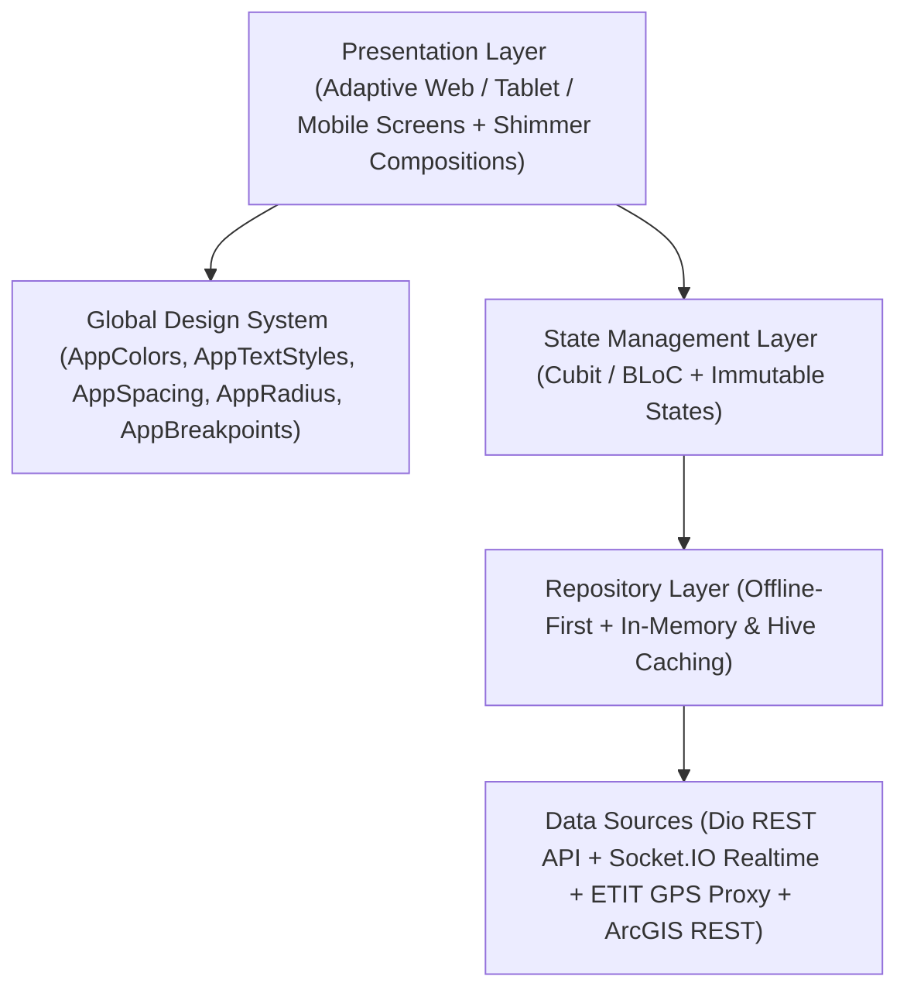

# Application Architecture (`incidents_managment`)

## 1. Architectural Overview

The **Minya Water & Wastewater Company Crisis, GIS, Valve & Fleet Management System** (`incidents_managment`) is architected as a modular, offline-capable, real-time Flutter application supporting **Flutter Mobile (Android/iOS), Tablet, and Flutter Web**.

---

## 2. Layered Structure

### 2.1 Core & Design System Layer (`lib/core/`)
- **Design System (`lib/core/design_system/app_design_system.dart`)**:
  - Centralizes `AppColors`, `AppTextStyles`, `AppSpacing`, `AppRadius`, `AppShadows`, `AppDurations`, `AppBreakpoints`, and reusable state feedback widgets (`AppEmptyState`, `AppErrorState`, `AppInlineRefreshBanner`).
- **Two-Level Shimmer System (`lib/core/widget/shimmer/`)**:
  - `shimmer_primitives.dart`: Level 1 primitives (`AppShimmerScope`, `ShimmerBox`, `ShimmerCircle`, `ShimmerLine`, `ShimmerText`, `ShimmerAvatar`, `ShimmerButton`, `ShimmerInput`, `ShimmerCard`, `ShimmerTableRow`, `ShimmerListItem`).
  - `screen_shimmers.dart`: Level 2 screen-specific shimmer skeletons tailored to each screen's exact layout.
- **Dependency Injection (`lib/core/di/dependcy_injection.dart`)**:
  - Uses `GetIt` (`getIt`) with `registerLazySingleton` for shared services/repositories (`Dio`, `ApiService`, `IncidentMapCubit`, `FleetRepository`, `FleetCubit`, `EtitGpsService`, `SecureStorageService`, `SessionManager`) and `registerFactory` for screen-scoped Cubits.
- **Networking & Offline Sync (`lib/core/network/` & `lib/core/offline/`)**:
  - `DioFactory` configures `AuthInterceptor`, `OfflineGetCacheInterceptor`, and `OfflineInterceptor`.
  - `SyncQueueEngine` + `IncidentCacheRepository` (Hive-backed) provide optimistic offline mutations and automatic replay on reconnection.

### 2.2 Feature Modules
1. **Home & Operations Dashboard (`lib/core/future/home/`)**:
   - Real-time Socket.IO incident stream (`IncidentMapCubit`), KPI strip, split-view incident list & details (`DashboardCubit`), live incident map (`IncidentsMapScreen` + `MapFilterCubit`), and user management (`UserManagementScreen`).
2. **Executive Reports & Analytics (`lib/core/future/reports/`)**:
   - Multi-dimensional analytics (`ReportsCubit`), chronological trend aggregation, status/severity/branch/type breakdowns, data quality metrics, and Excel/PDF export (`ReportExportService`).
3. **Actions — Incidents, Incident Types & Missions (`lib/core/future/actions/`)**:
   - Incident creation (`AddIncidentCubit` with cached branch lookup), incident types catalog (`AllIncidentTypeCubit` + `IncidentTypeFilterCubit`), missions catalog (`AllMissionsCubit` + `MissionsFilterCubit`), and mission-to-incident-type linking (`AddIncidentMissionCubit` + `MissionSelectionCubit`).
4. **Mission Assignment (`lib/core/future/mission_assigen/`)**:
   - Assigns field personnel (`AllActiveUserCubit` + `UserManagementFilterCubit` + `MissionSelectionCubit` + `MissionAssignCubit`) to active incident missions on both Web and Mobile.
5. **Valves & GIS Network (`lib/core/future/valve/` & `lib/core/future/gis/`)**:
   - Viewport-bounded valve clustering/filtering (`WebValveMapCubit`, `ValveFilterCubit`) and ArcGIS layer querying (`GisCubit`).
6. **ETIT GPS Fleet Management (`lib/features/fleet/` & `lib/features/valves_map/`)**:
   - Clean architecture module (`FleetRepository`, `FleetRepositoryImpl`, `FleetCubit`, `FleetState`, `FleetStatistics`, `FleetFilterParams`) powering `EtitVehiclesListScreen` and `EtitFleetMapScreen`.
