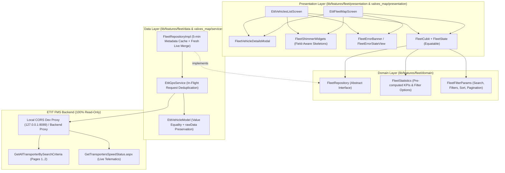

# ETIT GPS Fleet Management — Architecture After Refactoring

## 1. Architectural Overview

The ETIT GPS Fleet Management module has been refactored from monolithic `StatefulWidget` screens into a **Feature-First Clean Architecture** powered by **`FleetCubit`** (`flutter_bloc`), **`Equatable`** value semantics, and a **Two-Tier Caching Repository** registered in **`GetIt`**.



---

## 2. Folder & Module Structure

```text
lib/
├── core/
│   └── di/
│       └── dependcy_injection.dart              # Registers EtitGpsService, FleetRepository, FleetCubit
├── features/
│   ├── fleet/
│   │   ├── core/
│   │   │   ├── error/
│   │   │   │   └── fleet_failure.dart           # Sanitized Arabic FleetFailure hierarchy (Equatable)
│   │   │   ├── shimmer/
│   │   │   │   └── fleet_shimmer_widgets.dart   # Field-aware RTL Shimmer skeletons for List, Map & Modals
│   │   │   └── theme/
│   │   │       └── fleet_design_system.dart     # FleetColors, FleetSpacing, FleetRadius, FleetTextStyles, FleetDateFormatter
│   │   ├── data/
│   │   │   └── repositories/
│   │   │       └── fleet_repository_impl.dart   # 5-minute TTL base metadata cache + live GPS merge
│   │   ├── domain/
│   │   │   ├── entities/
│   │   │   │   ├── fleet_filter_params.dart     # Immutable filter/sort/pagination state + activeChips
│   │   │   │   └── fleet_statistics.dart        # Pre-computed KPI counts, percentages & dropdown options
│   │   │   └── repositories/
│   │   │       └── fleet_repository.dart        # FleetRepository interface & FleetSyncSnapshot
│   │   └── presentation/
│   │       ├── cubit/
│   │       │   ├── fleet_cubit.dart             # Non-overlapping polling, debounced search, sort, selection
│   │       │   └── fleet_state.dart             # Immutable FleetState with scoped getters
│   │       └── widgets/
│   │           ├── fleet_error_banner.dart      # Non-destructive inline banner & full error view
│   │           └── fleet_vehicle_details_modal.dart # Unified full-attribute vehicle dialog
│   └── valves_map/
│       ├── models/
│       │   └── etit_vehicle_model.dart          # Value equality (==, hashCode), copyWith, rawData
│       ├── services/
│       │   └── etit_gps_service.dart            # Preserved ETIT auth/session + in-flight deduplication
│       └── presentation/
│           └── screens/
│               ├── etit_vehicles_list_screen.dart # Cubit-driven Fleet Table/Card screen
│               └── etit_fleet_map_screen.dart     # Cubit-driven Live Map Tracking screen
└── test/
    └── features/
        └── fleet/
            └── fleet_cubit_test.dart            # Unit tests for Repository caching, Cubit, Filters & DateFormatter
```

---

## 3. State Management Flow (`FleetCubit` & `FleetState`)

1. **Cold Start (`FleetStatus.initial` -> `FleetStatus.loading`)**:
   - Displays field-aware shimmer skeletons (`FleetDashboardPageShimmer` on the list tab, `FleetMapShimmer` on the map tab).
2. **Warm Cache Hydration**:
   - When switching between the Fleet List and Live Map tabs, `FleetCubit.initialize()` checks `FleetRepository.getCachedSnapshot()`.
   - If a snapshot is already in memory, it hydrates the UI **instantly in 0ms** without flashing a loading state and triggers a silent background refresh (`FleetStatus.refreshing`).
3. **Background Refresh (`FleetStatus.refreshing`)**:
   - Keeps all current vehicles, KPI cards, map markers, and active filters visible on screen while rotating the header refresh icon.
   - If a transient network error occurs while data is already loaded, `FleetCubit` preserves the existing data and surfaces a dismissible `FleetErrorBanner` instead of wiping the screen.
4. **Scoped Widget Rebuilds**:
   - Every section (`_buildKpiCardsSection`, `_buildSearchAndActionsBar`, `_buildAdvancedFiltersBar`, `_buildVehiclesContent`, `_buildPaginationFooter`, `FlutterMap`, `_buildTopFloatingBar`, `_buildRightStackedControls`, `_buildStatusLegendCard`, `_buildSelectedVehicleCard`) uses `BlocBuilder<FleetCubit, FleetState>(buildWhen: ...)` so only the affected sub-tree rebuilds.
5. **Cross-Screen Synchronization**:
   - Clicking **"عرض على الخريطة"** on any vehicle in `EtitVehiclesListScreen` selects the vehicle in `FleetCubit` and opens `EtitFleetMapScreen` centered on that vehicle with its bottom details card open.
