# 05 — Navigation Architecture & End-to-End User Flow Audit

## 1. Current Navigation Architecture Overview

The application uses two distinct top-level navigation shells selected at login time (`LoginScreen` lines 47–52):
1. **Desktop / Web Shell (`CrisisDashboard`, `/crisis_dashboard`)**:
   - Uses a `260px` persistent right-hand RTL sidebar (`AppDrawer`) driving a 12-tab lazy `IndexedStack` (`Tabs 0..11`).
   - Tab `0` (`DashboardView`) embeds a nested `Navigator` (`DashboardRoutes.list` `/` and `DashboardRoutes.details` `/details`).
   - Secondary creation/editing screens (`AddIncidentType`, `AddMissions`, `EditMissions`, `MissionAssignScreen`, `FileUploadScreen`, `RegistrationScreen`) are pushed onto the root `Navigator` via `context.pushNamed(...)`, covering `CrisisDashboard`.
2. **Mobile Shell (`MobileIncidentsListScreen`, `/mobile_home`)**:
   - Uses a custom 5-slot Bottom Navigation Bar:
     - Slot 0: `الرئيسية` (stays on `MobileIncidentsListScreen`)
     - Slot 1: `أنواع الأزمات` (pushes `Routes.allIncidentType`)
     - Center FAB: `إضافة بلاغ` (pushes `Routes.addIncidentMobile`)
     - Slot 3: `المهام` (pushes `Routes.allMissions`)
     - Slot 4: `المزيد` (pushes `Routes.mobileMoreServices`)

---

## 2. Critical Navigation & User Flow Friction Points

### Flow 1 — User Administration & Account Registration (`UserManagementScreen` -> `RegistrationScreen`)
- **Current Flow (Broken on Web)**:
  1. Web Admin clicks `إدارة المستخدمين` in `AppDrawer` -> opens Tab `2` (`UserManagementScreen`).
  2. Admin wants to add a new employee account (`RegistrationScreen`).
  3. **Dead End**: `UserManagementScreen` has no "إضافة مستخدم" button, and `AppDrawer` only routes to `Routes.registration` when `isDesktop` is false!
- **Proposed Improved Flow**:
  1. Web Admin opens Tab `2` (`UserManagementScreen`).
  2. Clicks primary CTA `+ تسجيل مستخدم جديد` in `UserHeader`.
  3. Opens `RegistrationScreen` (with top back button) or a responsive modal dialog.
  4. Submits form -> `SuccessDialog` -> returns to `UserManagementScreen` and automatically calls `AllActiveUserCubit.refreshUsers()`.

---

### Flow 2 — Fleet List to Live Fleet Map Inspection (`FleetDashboardScreen` -> `FleetMapScreen`)
- **Current Flow (Traps User on Pushed Route)**:
  1. Operator opens Tab `11` (`إدارة أسطول المركبات` / `FleetDashboardScreen`) on Web or opens `Routes.etitFleetMap` from `MobileMoreServicesScreen` on Mobile.
  2. Clicks `الخريطة المباشرة` or `عرض على الخريطة` on a vehicle row (`fleet_dashboard_screen.dart` lines 78–92).
  3. App pushes `FleetMapScreen` via `Navigator.push` on top of `CrisisDashboard` (hiding the sidebar).
  4. **Friction**: `FleetMapFilterToolbar` has **no Back button**, so the operator has no visible UI control to return to the vehicle table or mobile menu!
- **Proposed Improved Flow**:
  1. Add a visible RTL Back button (`Icons.arrow_forward_rounded` / `العودة للقائمة`) to `FleetMapFilterToolbar` and `FleetTopHeaderBar` whenever `Navigator.of(context).canPop()` is true.
  2. When inside `CrisisDashboard` on Web, clicking `الخريطة المباشرة` can either switch directly to Tab `10` (preserving the sidebar) or push with a clear top-right Back button.

---

### Flow 3 — Editing a Standard Mission (`AllMissions` -> `EditMissions`)
- **Current Flow (Double-Pop Bug)**:
  1. Operator opens `AllMissions` (Tab `6` on Web or `Routes.allMissions` on Mobile) and clicks the Edit icon on a mission card.
  2. App pushes `EditMissions` (`Routes.editMissions`). On Web, a mobile banner stretches across the entire monitor.
  3. Operator edits the mission name and clicks `حفظ التعديلات`.
  4. `SuccessDialog.show` appears. Operator clicks `موافق`.
  5. **Bug**: `SuccessDialog` pops itself, and then `onPressed` executes `context.pop(); Navigator.pop(context, true);` (`edit_missions.dart` lines 45–46), popping **both** `EditMissions` AND the underlying screen (`CrisisDashboard` or `AllMissions`)!
- **Proposed Improved Flow**:
  1. Operator clicks Edit -> opens responsive `EditMissions` (constrained card on Web) with inline loading on the Save button.
  2. On success, `SuccessDialog` closes and pops **only** `EditMissions` with `true`, triggering `AllMissionsCubit.refresh()` on the parent screen.

---

### Flow 4 — Linking Standard Missions to an Incident Type (`Addincidentmission`)
- **Current Flow (Triple Header & Unclosed Error Spinner)**:
  1. Operator selects Tab `7` (`ربط المهام بالأزمات`) in `CrisisDashboard`.
  2. Sees 3 stacked headers (`_DesktopSectionHeader` + `_buildTopBanner` + `LinkMissionsHeader`). If the operator clicks the back arrow inside `_buildTopBanner`, it pops `CrisisDashboard`!
  3. Operator selects an incident type, orders missions, and clicks `حفظ الإعدادات`.
  4. A blocking raw `CircularProgressIndicator` dialog opens. If the API returns an error, `ErrorDialog` opens on top of the still-open spinner dialog!
- **Proposed Improved Flow**:
  1. Tab `7` renders a single clean header without the mobile `_buildTopBanner` back arrow when embedded in `CrisisDashboard`.
  2. Clicking `حفظ الإعدادات` shows an inline spinner inside `SaveConfigurationBar` (no blocking raw dialog), cleanly handling both success and error states.

---

### Flow 5 — Mobile Incident Field Inspection & Mission Update (`MobileIncidentsListScreen` -> `MobileIncidentDetailsScreen`)
- **Current Flow (Excessive Scroll Depth)**:
  1. Field engineer taps an incident card on `MobileIncidentsListScreen`.
  2. `MobileIncidentDetailsScreen` opens. To update a mission status or upload a field photo, the engineer must scroll past the Hero Banner, Status Card, 6 Metadata Tiles, Interactive Map, and Notes Card (`~1,800px` of scrolling).
- **Proposed Improved Flow**:
  1. Field engineer opens `MobileIncidentDetailsScreen`.
  2. Immediately below the top summary header, a sticky 3-tab bar (`نظرة عامة والموقع` | `المهام والتدخل` | `الصور والسجل`) and quick action buttons (`تحديث الحالة`, `تعيين مهام`, `إرفاق صورة`) allow 1-tap access to Missions or Photos with zero vertical scrolling.

---

## 3. Navigation Architecture Diagram (Proposed Unified Flow)

```mermaid
flowchart TD
    Login["LoginScreen (/login)"] -->|Authenticated| ShellRouter["Responsive Platform Shell"]
    
    subgraph WebDesktop["Web & Tablet Shell (CrisisDashboard)"]
        Sidebar["Collapsible AppDrawer (260px <-> 72px)"]
        Sidebar --> T0["Tab 0: Incident Command (35:65 Split / Grid)"]
        Sidebar --> T1["Tab 1: Live Incidents Map"]
        Sidebar --> T3["Tab 3: Executive Reports (8 Sub-Tabs)"]
        Sidebar --> T8["Tab 8: Valves & Proximity Map"]
        Sidebar --> T9["Tab 9: GIS Network Map (Floating HUD)"]
        Sidebar --> T10["Tab 10: Live Fleet Map (ETIT)"]
        Sidebar --> T11["Tab 11: Fleet Vehicles Directory"]
        Sidebar --> T4["Tab 4: Report New Incident"]
        Sidebar --> T5["Tab 5: Incident Types"]
        Sidebar --> T6["Tab 6: Standard Missions"]
        Sidebar --> T7["Tab 7: Link Missions to Type"]
        Sidebar --> T2["Tab 2: User Management"]
    end

    subgraph MobileShell["Mobile Shell (MobileIncidentsListScreen)"]
        BNav["Bottom Nav: Home | Types | +Add | Missions | More"]
        BNav --> MHome["Mobile Incidents Feed"]
        MHome --> MDetails["MobileIncidentDetailsScreen (3-Tab View)"]
        BNav --> MMore["MobileMoreServicesScreen (Includes Reports & Users)"]
    end

    T2 -->|"+ تسجيل مستخدم جديد"| Reg["RegistrationScreen (/registration)"]
    T5 -->|"+ إضافة نوع أزمة"| AddType["AddIncidentType (With Top Back CTA)"]
    T6 -->|"+ إضافة مهمة"| AddMission["AddMissions (With Top Back CTA)"]
    T6 -->|"تعديل"| EditMission["EditMissions (Single Pop + Web Constrained)"]
    T0 & MDetails -->|"تعيين مهام"| Assign["MissionAssignScreen (/mission_assign)"]
    T0 & MDetails -->|"إضافة صورة"| Upload["FileUploadScreen (/add_Image_Screen)"]
```

